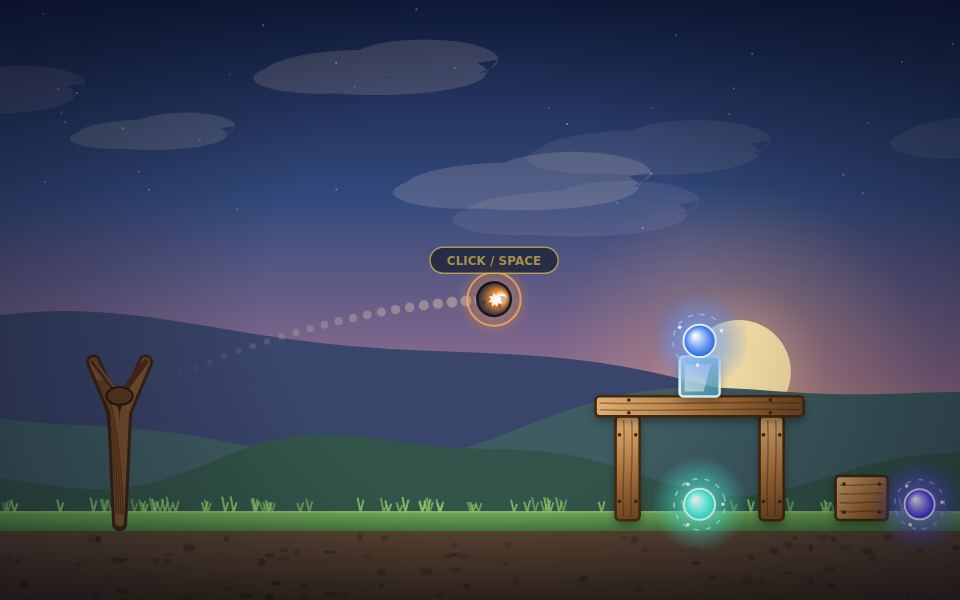
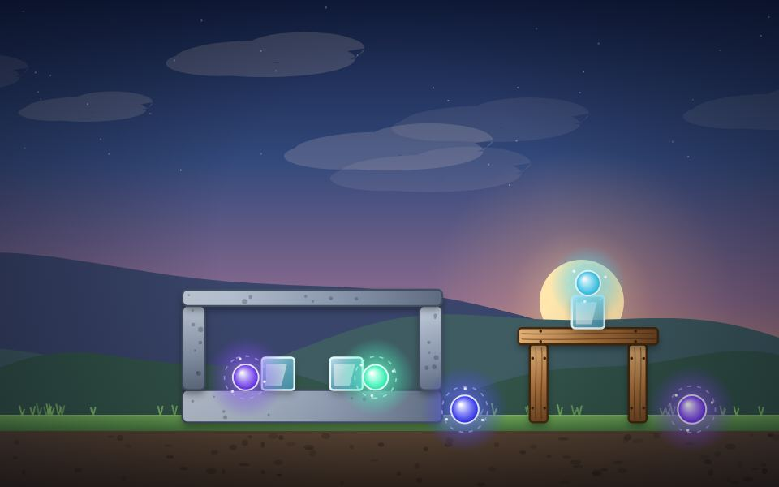
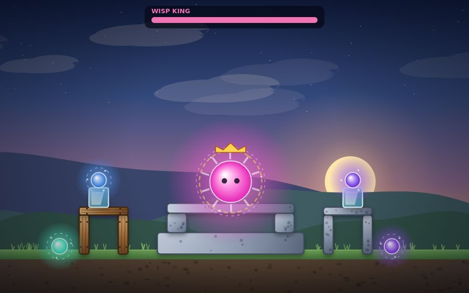
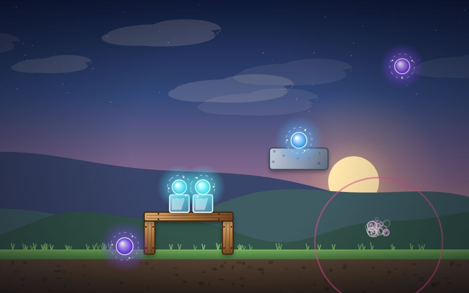
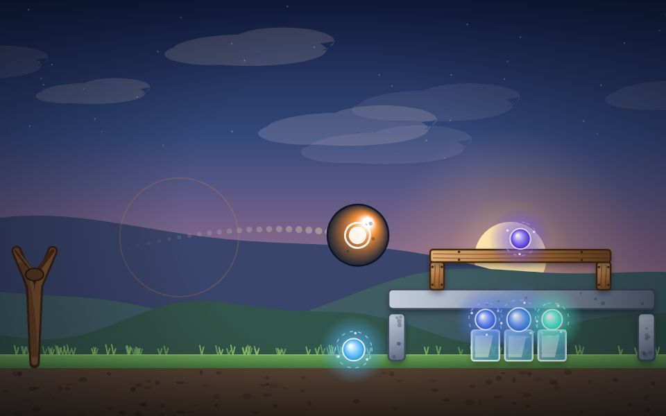

# Slingstone

An original open-source slingshot physics game for PC browsers, built with **Matter.js** rigid-body physics, procedurally drawn Canvas graphics, and synthesized Web Audio sound.



> This repository was originally created for a proposed Angry Birds 1.0 PC port. That work is paused pending written permission from the rights holder. Slingstone is a separate, lawful deliverable: it borrows only *genre mechanics* (slingshot launching, breakable structures, tappable shot abilities, star ratings) and contains no Angry Birds binaries, artwork, audio, characters, level data, or trademarks.

## Play

```bash
python3 -m http.server 8000 --bind 0.0.0.0
```

Then open the preview URL shown by Arena, or `http://localhost:8000`. Opening `index.html` directly also works in a modern browser, but a local server is recommended.



## What's new in v2.1

- **Ten levels.** Seven brand-new levels (4–10) expand the campaign with pillars, turrets, glass towers and stacked fortresses.
- **A boss on level 10 — "The Wisp King."** A big crowned, armored wisp with its own **HP bar**. It holds its ground (a static body), shrugs off the Bubble lift, and soaks up multiple hits — land heavy strikes or chain explosions to bring it down. Worth 2,500 points.
  
- **Three new stones:**
  - **Bubble (pink)** ◎ — *Uplift*: release a rising column that floats nearby blocks and wisps up and off the top of the world (the boss is too heavy to lift). 
  - **Inflator (orange)** ◉ — *Inflate*: swell into a giant heavy ball that crushes everything it touches; it gains mass as it grows, so it hits far harder. 
  - **Boulder** ◆ — a big, heavy, strong stone with no ability but enormous impact damage.

## What's new in v2.0

- **Real rigid-body physics.** The hand-rolled physics loop was replaced with [Matter.js](https://brm.io/matter-js/) 0.20.0 (MIT, vendored locally). Blocks stack, topple, tumble and transfer momentum properly, with sleeping bodies for stability.
- **Destructible materials.** Wood, glass and stone have different densities, hit points and break effects. Blocks visibly crack as they take damage before shattering into debris.
- **Four stone types with mid-flight abilities.** Click, tap, or press **Space** while a shot is in the air:
  - **Pebble** — reliable all-rounder, no ability.
  - **Bolt** ⚡ — *Surge*: a burst of extra speed.
  - **Bomber** ✸ — *Blast*: detonate for a radial shockwave and area damage.
  - **Splitter** ✦ — *Scatter*: split into three smaller stones.
- **Camera.** The world is wider than the viewport. A short flyover shows each level on load, the camera tracks your shot in flight, and **Peek at targets** (hold, or press **V**) pans to the far end.
- **Star ratings and progress.** Earn up to three stars per level based on stones left over, plus a leftover-stone score bonus. Best stars are saved in `localStorage`.
- **Full art pass.** Layered parallax sunset sky, drifting clouds, stars, a glowing sun, three mountain ranges, textured soil and grass, gradient-shaded planks/stone/glass, glowing wisps with orbiting sparks, debris, shockwaves, screen shake, damage cracks, floating score popups, and a shot trail.
- **Result overlay** for level clear and failure, a stone queue in the toolbar, a power gauge, an aiming trajectory preview, and a sound toggle.

## Controls

| Action | Input |
| --- | --- |
| Aim and launch | Drag the stone back from the slingshot, release |
| Use a stone's ability | Click / tap the canvas, or press **Space**, while the shot is in flight |
| Peek at the far targets | Hold **Peek at targets**, or press **V** |
| Restart level | **Restart** button, or **R** |
| Next level | **Next Level** button, or **N** |
| Toggle sound | **Sound** button, or **M** |

The stone queue shows what is coming up next. Pull farther back for more power — the HUD and the on-canvas gauge show your charge. A new stone loads automatically once the previous shot settles.

## Files

| File | Purpose |
| --- | --- |
| `index.html` | Game page and UI |
| `style.css` | Layout, HUD, overlay, and result-card styling |
| `game.js` | Game logic, levels, abilities, effects, procedural rendering, audio |
| `vendor/matter.min.js` | Matter.js 0.20.0 physics engine (MIT) |
| `vendor/MATTER_LICENSE.txt` | Matter.js MIT license text |
| `THIRD_PARTY_NOTICES.md` | Third-party licensing notices |
| `docs/GAME_DESIGN.md` | Design and technical notes |
| `tools/build_release.py` | Builds the release zip |
| `tools/test_game.js` | Headless gameplay regression tests |

The legacy rights-gated porting tooling remains in `tools/port_assets.py`, `tools/test_port_assets.py`, and the other documents under `docs/`. See [docs/PERMISSION_DOCUMENTS_INDEX.md](docs/PERMISSION_DOCUMENTS_INDEX.md) for the draft permission/agreement documents. Nothing from the paused port attempt is included in the Slingstone release.

## Build the release archive

```bash
python3 tools/build_release.py
```

This creates `dist/Slingstone-2.1.0.zip` containing the game, the vendored Matter.js build, its license, notices, docs, and preview images.

## Validation

```bash
node --check game.js
node tools/test_game.js
python3 tools/build_release.py
python3 tools/test_port_assets.py
```

`tools/test_game.js` runs the **real** game loop and Matter.js physics against a stub DOM/canvas in Node. Its 101 assertions cover repeated shots, structure stability, out-of-stones handling, reachability and settling stability of all ten levels, destructible blocks, every ability (including the three new stones and the boss), star awards, camera/flyover/peek, and the sound toggle. No browser or `npm install` is needed because Matter.js is vendored.

GitHub Actions runs these checks on pushes, pull requests, and `v*-slingstone` tags.

## License

Original game code and documentation are licensed under the MIT License. See [LICENSE](LICENSE).

Matter.js is licensed separately under the MIT License; see [vendor/MATTER_LICENSE.txt](vendor/MATTER_LICENSE.txt).

Slingstone is an independent original game. It is not affiliated with, endorsed by, or sponsored by Rovio Entertainment Ltd. or any other game publisher.

*This repository is maintained by the project owner; this document is not legal advice.*
